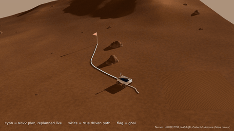
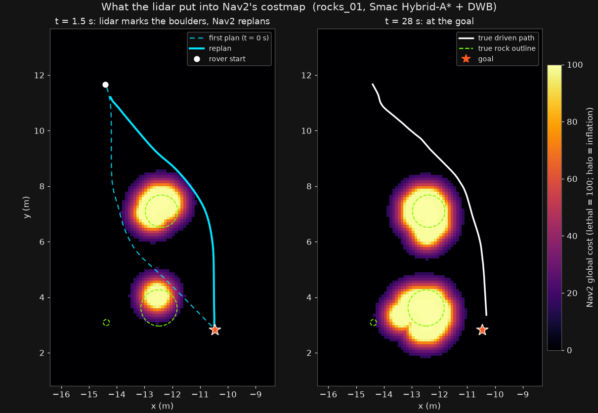

# Mars Yard in MuJoCo

[](https://github.com/BrunoFiorindoPaschoal/Mars_Rover_Navigation/actions/workflows/ci.yml)

A skid-steer rover on HiRISE Jezero crater terrain, simulated in MuJoCo and driven autonomously by ROS 2 Jazzy Nav2 through `mujoco_ros2_control`.

**What is in it**
- **Simulation:** a MuJoCo world generated from a real HiRISE DTM (50 × 50 m of Jezero crater at 0.1 m/px, as heightfield tiles), with boulders and sand patches; the rover is a skid-steer MJCF/URDF pair with a pivoting front axle.
- **C++ MuJoCo plugins:** `RayScanPlugin` (2D/3D ray-cast lidar, one plugin instead of 360 rangefinders) and `TeleportPlugin` (in-sim rover reset over a ROS service, 1.4 s vs 16.7 s per relaunch).
- **ROS 2 stack:** `ros2_control` diff-drive, a `robot_localization` EKF (wheel odometry + gyro), a 3D-lidar step-height hazard mapper feeding Nav2 costmaps, and switchable planners (NavFn, Smac Hybrid-A*) and controllers (DWB, MPPI, RPP).
- **Evaluation:** a C++ metrics node scored against MuJoCo ground truth, a 20-scenario benchmark (flat / slope / rocks / sand), and domain randomization levels 0–3 (friction, mass, centre of mass, motor gain, sensor noise, latency).
- **Engineering:** a Docker image, plus GitHub Actions CI that runs the gtest and pytest suites inside it; [DEVLOG.md](DEVLOG.md) records every design decision with the alternatives that were rejected.

<table>
<tr>
<td width="50%"><a href="media/hero.mp4"></a></td>
<td width="50%"></td>
</tr>
</table>

*Left: a recorded benchmark run (`rocks_01`, Smac Hybrid-A* + DWB). Nav2's plan (cyan, replanned every second) bends around two boulders; the white line is the true driven path from MuJoCo. Every pose and wheel angle comes from the physics run, and Blender only renders it. Click for the full 30 s video ([how it is made](#hero-video)). Right: what the robot saw. The first plan was made before any hazard was marked and cuts through a boulder; 1.5 s later the 3D-lidar hazard detector has put both boulders into the global costmap (lethal core + inflation halo, matching the true rock outlines) and the replan goes around. The costmap comes from a re-run of the same scenario with costmap recording on (same outcome: 0.57 m vs 0.56 m from the goal). Each package has its own README under `src/`.*

## Setup (WSL2, Ubuntu 24.04)

```bash
./tools/setup_wsl.sh
```

Or with Docker (same dependencies; CI builds this image and runs the gtest + pytest suites inside it on every push; the simulation checks are not run in CI):

```bash
docker build -t mars-yard .
docker run --rm -it mars-yard     # shell with the workspace built and sourced
```

Launch the ROS 2 + MuJoCo simulation (`world:=flat` or `world:=mars`):

```bash
ros2 launch mars_yard_bringup sim.launch.py world:=mars
```

## Navigate

Launch MuJoCo, EKF, 3D lidar hazard mapping, Nav2, and RViz2 in one command (default planner/controller: `smac_hybrid` + `dwb`):

```bash
ros2 launch mars_yard_bringup sim.launch.py world:=mars nav:=true
```

In RViz2, select the **2D Goal Pose** tool in the top toolbar, then click and drag anywhere on the map (in frame `map`) to send a goal to `/goal_pose`. Optional overlays: `planner:=navfn|smac_hybrid` and `controller:=dwb|mppi|rpp`.

Headless verification:

```bash
./tools/check_nav.sh mars smac_hybrid dwb
./tools/check_teleport.sh
```

## Benchmark

20 fixed scenarios on the Jezero Mars world (`src/mars_yard_benchmark/config/scenarios.yaml`, 5 per group: `flat`, `slope`, `rocks`, `sand`), evaluated across 6 planner × controller combinations (`navfn | smac_hybrid` × `dwb | mppi | rpp`) using in-sim rover resets (`~1.4 s` per reset vs `~16.8 s` per relaunch).

Run the full 600-run matrix (6 combos × 20 scenarios × 5 seeds, headless, resumable, ~5–6 h overnight):

```bash
./tools/run_matrix.sh --seeds 5
```

Or run a smaller subset (e.g., 1 seed on two scenarios):

```bash
./tools/run_matrix.sh --seeds 1 --scenarios slope_04,rocks_01
```

Produce summary tables (`results/benchmark/summary.md`) and plots (`results/benchmark/plots/`):

```bash
python3 -m mars_yard_benchmark.analysis \
  --csv results/benchmark/benchmark.csv \
  --out-md results/benchmark/summary.md \
  --plots-dir results/benchmark/plots
```

### Pilot results (30 runs, 1 seed)

The default combo ran all 20 scenarios; the other five ran `slope_04` and `rocks_01` only. Full tables: [`results/benchmark/summary.md`](results/benchmark/summary.md). The 600-run matrix above has not been run yet.

| Planner + Controller | Success | Time (s) | Path ratio | Tracking err (m) | Energy (J) |
|---|---:|---:|---:|---:|---:|
| `smac_hybrid + dwb` | **20/20** | 26.6 ± 4.4 | 0.979 | 0.105 | 426 |
| `navfn + dwb` | 2/2 | 32.6 ± 6.2 | 0.991 | 0.117 | 350 |
| `navfn + rpp` | 2/2 | 32.0 ± 5.9 | 0.993 | 0.134 | 464 |
| `smac_hybrid + rpp` | 2/2 | 32.8 ± 5.3 | 1.014 | 0.399 | 536 |
| `navfn + mppi` | 1/2 | 32.4 | 1.000 | 0.300 | 507 |
| `smac_hybrid + mppi` | 0/2 | — | — | — | — |

All three MPPI failures are `goal_miss`es: Nav2 reported success, but the true rover ended 4.1–5.1 m (on the 14.5° cross-slope) or 1.45 m (in the rock field) from the goal.

Success means Nav2 `SUCCEEDED` **and** the ground-truth rover ends within 1.0 m of the goal; otherwise the run is a `goal_miss` (the EKF thought it arrived).

## Robustness

The benchmark under 4 randomization levels: friction, chassis mass and centre of mass, per-wheel motor gain (MJCF), lidar range noise and dropout, gyro noise and bias, command latency (relays). Level 0 is the unchanged benchmark stack.

```bash
ros2 launch mars_yard_bringup sim.launch.py world:=mars nav:=true rand_level:=2   # one randomized world
./tools/check_randomization.sh                                                   # perturbations measured in the running sim
./tools/run_robustness.sh --levels 0,1,2,3 --seeds 2                              # full study, ~11 h (960 runs)
python3 -m mars_yard_benchmark.robustness_analysis                               # results/robustness/summary.md + plots
```

Pilot (planner `smac_hybrid`; scenarios `flat_01`, `slope_04`, `rocks_01`, `sand_01` × 2 seeds; true success):

| Controller | L0 | L1 | L2 | L3 |
|---|---:|---:|---:|---:|
| DWB | 8/8 | 8/8 | 6/8 | 6/8 |
| MPPI | 4/8 | 4/8 | 5/8 | 4/8 |
| RPP | 8/8 | 7/8 | 7/8 | 5/8 |

22 of the 24 failures are `goal_miss` on the 14.5° cross-slope (`slope_04`) and in the rock field: with lower friction the rover slides downhill, and the EKF (wheel speed + gyro) cannot see it. See `results/robustness/plots/` and DEVLOG Phase 7.

## Hero video

Replays a recorded benchmark bag in MuJoCo (no physics, `qpos` from the bag each frame) and renders it in Blender 5.3:

```bash
python3 tools/bag_to_trajectory.py results/benchmark/bags/smac_hybrid_dwb__rocks_01__s0 --out media/hero/trajectory.npz  # system python, ROS sourced
.venv/bin/python tools/export_usd.py media/hero/trajectory.npz --out media/hero/export   # rover+rocks USD, terrain OBJ, plans
blender -b -P tools/blender/build_scene.py -- --export media/hero/export --anim --out frames/ --samples 32
tools/blender/encode.sh frames/ media                                                      # hero.mp4 (720p) + hero.gif
```

The costmap figure needs a bag with the costmap in it, so it re-runs the scenario with extra topics recorded:

```bash
BAG_EXTRA_TOPICS="/global_costmap/costmap /hazards" ./tools/run_matrix.sh --seeds 1 --scenarios rocks_01 \
  --combos smac_hybrid+dwb --output-csv results/figure/run.csv --bags-dir results/figure/bags --log-file results/figure/run.log
python3 tools/bag_to_costmap.py results/figure/bags/smac_hybrid_dwb__rocks_01__s0 --out media/hero/costmap.npz
.venv/bin/python tools/plot_costmap_figure.py media/hero/costmap.npz --out media/costmap_rocks_01.png
```

On an RTX 2060, Eevee at 1080p and 32 samples takes about 8.5 s per frame (about 2 h for the 28 s run). The Phase 2 open-loop MuJoCo render is still in `media/tier_a.gif` (`tools/render_tier_a.py`).

## Known limitations

- **No global localization:** `map → odom` is a static identity, and the EKF fuses only wheel odometry and gyro yaw rate. Downhill slip is invisible to it, which is the root cause of most `goal_miss` failures. A terrain-relative or visual odometry source would be the next step.
- **Skid-steer kinematics:** `diff_drive_controller` uses an empirical wheel-separation multiplier (2.94) that does not hold at every yaw rate (on the slope, −0.52 rad/s commanded gave −1.05 rad/s; DEVLOG Phase 5b), and in-place turns slide downhill on steep slopes.
- **Terrain resolution:** the DTM's true resolution is about 1 m. Detail below that is bicubic interpolation; small-scale roughness comes only from the rock geoms.
- **Randomization confound:** each randomization level uses one physics sample, so level and sample effects are not yet separated.
- **CI scope:** CI runs the unit tests only; the closed-loop simulation checks (`tools/check_*.sh`) run locally.

## Docs
- [DEVLOG.md](DEVLOG.md): design decisions, with the reasons for each
- [STUDY_GUIDE.md](STUDY_GUIDE.md): the core parts of the code and how to study them

## License
Code: [MIT](LICENSE). HiRISE terrain data: NASA/JPL-Caltech/UArizona.
