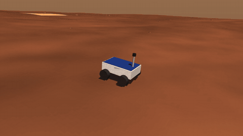

# Mars Yard in MuJoCo

A skid-steer rover on HiRISE Jezero crater terrain, simulated in MuJoCo and driven autonomously by ROS 2 Jazzy Nav2 through `mujoco_ros2_control`.

> Work in progress. This README claims only what the repo currently shows.



*Current state (Phase 2): a fixed open-loop drive on the real terrain, with no ROS or navigation yet. Render it with `MUJOCO_GL=egl .venv/bin/python tools/render_tier_a.py`.*

## Setup (WSL2, Ubuntu 24.04)

```bash
./tools/setup_wsl.sh
```

## Docs
- [DEVLOG.md](DEVLOG.md): design decisions, with the reasons for each
- [STUDY_GUIDE.md](STUDY_GUIDE.md): the core parts of the code and how to study them

## Credits
HiRISE terrain data: NASA/JPL-Caltech/UArizona.
